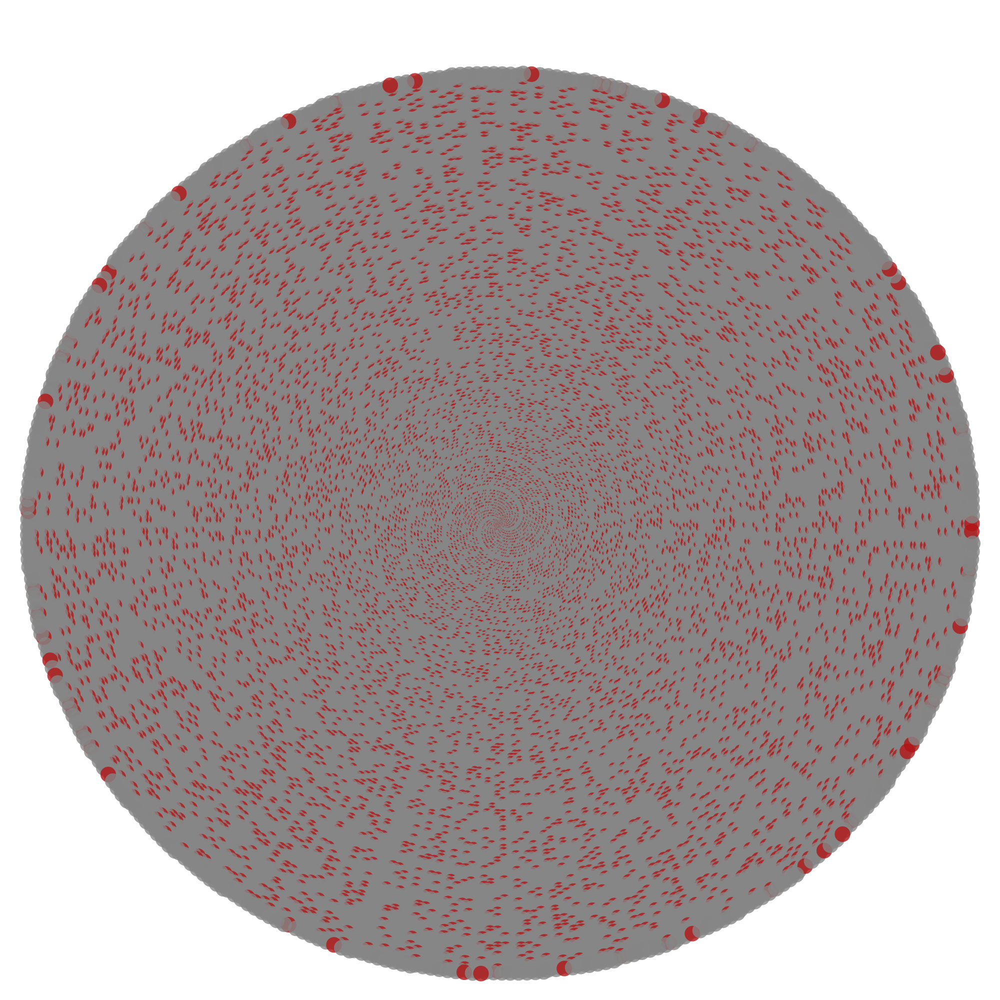

# Beauty of Numbers

> Студия математического искусства: превращает числовые последовательности — в первую очередь простые числа — в изображения.
>
> A math-art studio that turns number sequences — primes first — into images.

Русский | [English ↓](#english)



---

## Русский

### Что это

Beauty of Numbers — десктопное приложение (WPF, .NET 8) для генерации изображений из чисел. Каждое число `n` получает точку на плоскости, а классификатор (простое / составное) задаёт её цвет. Основа проекта — семейство спиральных раскладок: архимедова, Улам, Сакс, гексагональная.

Формула продукта:

**Последовательность × Раскладка × Стиль → Пресет → Экспорт**

### Статус

Фундамент M0 готов, M1 закрыт: рендер на SkiaSharp, живое превью с debounce и отменой, батчинг точек, бенчмарки. Текущая веха — M2 (студия: пресеты, палитры, экспорт с размером/DPI, семейство раскладок) — см. [roadmap](docs/01-product/roadmap.md).

### Возможности (сейчас)

- Архимедова спираль (`r = n`, `θ = n`); диапазон задаётся как `[Start, Start + Count)` (UI: count от 10 до 100 000; CLI: до 1 000 000; конец диапазона до 100 000 000).
- Решето Эратосфена в ядре; простые числа подсвечиваются отдельным цветом, фильтр «только простые» — чекбокс в студии и `--only-primes` в CLI.
- WPF-студия: диапазон, цвета, размер точек, живое превью с панорамой (ЛКМ) и зумом (колесо), сохранение PNG без временных файлов.
- CLI: одиночный рендер PNG; пресеты и пакетный рендер — M3.

### Быстрый старт

Требуется .NET 8 SDK.

```powershell
dotnet build BeautyOfNumbers.sln
dotnet run --project src/BeautyOfNumbers.App.Wpf   # студия (WPF)
dotnet run --project src/BeautyOfNumbers.Cli       # CLI: plot.png в рабочей папке
dotnet test                                        # тесты ядра и рендера
```

### Структура репозитория

| Путь | Назначение |
| --- | --- |
| `src/BeautyOfNumbers.Core/` | ядро: диапазон, классификаторы простоты, раскладки, стиль, запросы, валидация, пресеты; без внешних зависимостей |
| `src/BeautyOfNumbers.Rendering/` | рендер на SkiaSharp: сцена → пиксели, батчинг, экспорт PNG |
| `src/BeautyOfNumbers.Cli/` | консольный рендер |
| `src/BeautyOfNumbers.App.Wpf/` | WPF-студия (MVVM) |
| `tests/BeautyOfNumbers.Core.Tests/` | юнит-тесты ядра (xUnit) |
| `tests/BeautyOfNumbers.Rendering.Tests/` | смоук-, детерминизм- и паритет-тесты рендера |
| `benchmarks/BeautyOfNumbers.Benchmarks/` | локальные замеры производительности (BenchmarkDotNet) |
| `docs/` | документация: от продукта до математики |

### Документация

- [Продукт: видение](docs/01-product/vision.md)
- [Сценарии использования](docs/01-product/use-cases.md)
- [Дорожная карта](docs/01-product/roadmap.md)
- [Вне рамок проекта](docs/01-product/non-goals.md)
- [Глоссарий](docs/01-product/glossary.md)
- [Архитектура](docs/02-architecture/overview.md)
- [Как собрать и запустить](docs/03-guides/build-and-run.md)
- [Стратегия тестирования](docs/03-guides/testing.md)
- [Бенчмарки](docs/03-guides/benchmarks.md)
- [Математика раскладок](docs/04-math/layouts.md)
- [Полный индекс документации](docs/README.md)

### Лицензия

MIT — см. [LICENSE](LICENSE).

---

## English

### What it is

Beauty of Numbers is a desktop WPF app (.NET 8) that renders number sequences as images. Each number `n` becomes a point; a classifier (prime / composite) picks its color. The core idea is a family of spiral layouts: Archimedean, Ulam, Sacks, hexagonal.

Product formula:

**Sequence × Layout × Style → Preset → Export**

### Status

The M0 foundation is set and M1 is closed: SkiaSharp rendering, live preview with debounce and cancellation, point batching, and benchmarks. M2 (studio: presets, palettes, sized/DPI export, the spiral layout family) is next — see the [roadmap](docs/01-product/roadmap.md).

### Quick start

Requires .NET 8 SDK.

```powershell
dotnet build BeautyOfNumbers.sln
dotnet run --project src/BeautyOfNumbers.App.Wpf   # WPF studio
dotnet run --project src/BeautyOfNumbers.Cli       # CLI: renders plot.png in the working directory
dotnet test                                        # core and rendering tests
```

### License

MIT — see [LICENSE](LICENSE).

### Documentation

Documentation is written in Russian, with this README kept bilingual. Start with the [docs index](docs/README.md).
